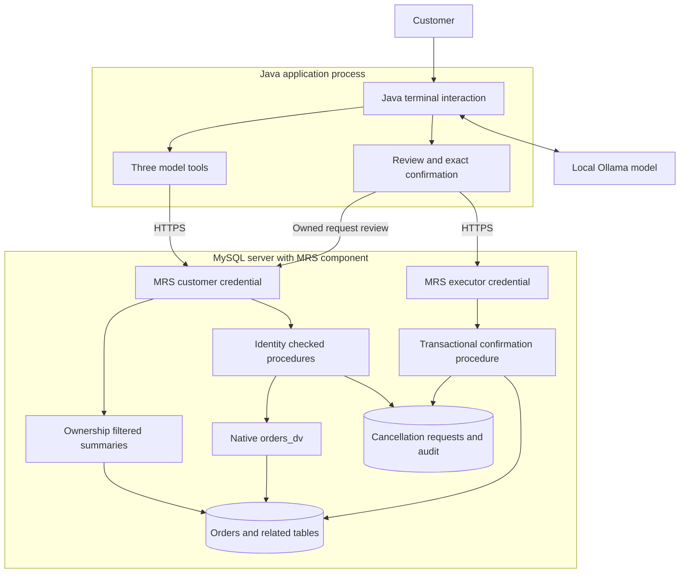

# Giving a Java AI Agent Controlled Access to MySQL with MRS

By A N M Bazlur Rahman

In my [earlier article on MySQL JSON Duality Views](https://foojay.io/today/one-database-two-models-mysql-json-duality-views-java/), I built a Java application that reads an order, its customer, and its line items as one JSON document. The data still lives in four relational tables. A small AI assistant uses Java tools to answer questions about those orders.

The next useful request sounds simple: “Cancel order 1003. I ordered it by mistake.”

That changes the problem. Reading an order requires deciding which information the assistant may see. Cancelling it requires deciding which action it may take, whose order it may affect, and whether the order is still cancellable when the action reaches the database.

I extended the project with MySQL REST Service, or MRS, and a separate Java agent module. The model can read the authenticated customer's orders and create a pending cancellation request. A separate application path reviews and confirms that request. MySQL checks the current order state inside the transaction that performs the cancellation.

The working example uses real HTTPS endpoints, MRS authentication, database ownership checks, and a local language model. It also has some limitations worth examining, including a compatibility surprise when exposing the existing duality view.

## What changes from the previous application

The earlier assistant already had read-only tools. It could not generate arbitrary SQL, and the model did not receive database credentials. However, its Java process used JDBC, and customer scoping depended on the application. The database account could read documents belonging to multiple customers.

This version moves the runtime database interface behind MRS. The new Java module has no JDBC driver, connection pool, or database password. It authenticates as an MRS user and calls a fixed set of HTTPS operations. MRS permissions and SQL ownership checks still apply if someone bypasses the chatbot and calls those endpoints directly.

That last point matters. Hiding a button or omitting a model tool does not secure the endpoint underneath it.

I kept the original application intact. The follow-up runs in its own Compose project and database volume, using MySQL **26.10.0 Community** and the in-server MRS component. This deployment does not need a separate MySQL Router process. Oracle's [component setup guide](https://blogs.oracle.com/mysql/getting-started-with-the-mysql-rest-service-component) describes this deployment option and its matching MySQL Shell version.

The tested Java stack is Java 25, LangChain4j 1.20.0, Jackson, and the JDK HTTP client. The module uses Spring Boot 4.1.1 for dependency management and executable-jar packaging, but it is a terminal application, without a Spring web server. Ollama supplies the local model.

## Where each decision happens

There are three separate kinds of authority in this application:

- **Java tools** define the operations the model may ask for.
- **MRS authentication and authorization** bind requests to an identity and restrict the accessible endpoints and rows.
- **SQL procedures** enforce ownership, cancellation policy, concurrency rules, and atomic changes.

Human confirmation belongs to trusted Java code outside the model's tool set.



The credential labels describe the identities presented to MRS; passwords and tokens remain in the Java clients. They are not tool arguments or model context.

The executor credential lives in the same application process in this demo. This separates model authority from application authority, but it does not isolate confirmation from a compromised Java process. A stronger deployment would put that capability in a separate service and bind it to authenticated user consent.

## First check whether the existing duality view fits

The original schema contains `customers`, `orders`, `order_items`, and `products`. Its native `orders_dv` view produces a nested JSON document with an order ID, status, customer, items, and `_metadata.etag`.

Those native view definitions loaded unchanged on the tested MySQL version. My first attempt to wrap the document in a conventional SQL view did not work:

```sql
CREATE VIEW order_document_wrapper AS
SELECT data FROM order_demo.orders_dv;
```

MySQL returned:

```text
6504 / HY000
JSON DUALITY VIEW orders_dv cannot be used with a normal SQL view.
```

I wanted that wrapper so I could add an ownership column alongside the document. The failure ruled out that particular approach. It does not establish that every possible direct MRS mapping of a native duality view is unsupported.

The working solution exposes a checked stored procedure. MRS supplies the authenticated principal; SQL maps it to a customer and reads the native document with both predicates in the same statement:

```sql
SELECT d.data INTO v_document
FROM orders_dv d
WHERE d.data->'$._id' = p_order_id
  AND d.data->'$.customer.id' = (
    SELECT customer_id
    FROM customer_principals
    WHERE principal_id = p_user_id
  );
```

This is an excerpt from [the get_order procedure](https://github.com/rokon12/order-duality/blob/2516fae6f35fe6e16fc6de3a0744db40be5c08a4/mrs/workflow.sql), not its complete definition. The procedure returns either the document or an `ORDER_UNAVAILABLE` business result. A caller cannot distinguish another customer's order from a missing order through that result.

The nested JSON and native etag reach Java intact. Cancellation uses a relational transaction and an explicit order version; it does not replace the whole duality document or use its etag as the workflow's concurrency token.

There are two similar names to keep straight. Native server views use `CREATE JSON DUALITY VIEW`. MRS's REST data mapping uses `CREATE REST VIEW`. They are different mechanisms. This example combines the existing native view with an MRS procedure endpoint, rather than presenting it as transparent REST CRUD over that view. The [MRS SQL reference](https://dev.mysql.com/doc/dev/mysql-rest-service/latest/sql.html) documents the REST definitions.

## Expose the operations the application needs

For recent-order summaries, an ordinary SQL projection joins orders to `customer_principals`. The [MRS endpoint definition](https://github.com/rokon12/order-duality/blob/2516fae6f35fe6e16fc6de3a0744db40be5c08a4/mrs/endpoints.sql) is small:

```sql
USE REST SERVICE /orders;
USE REST SCHEMA /shop;

CREATE OR REPLACE REST VIEW /orders AS order_demo.order_summaries {
  orderId: id @KEY @SORTABLE,
  owner: principal_id @ROWOWNERSHIP,
  status: status,
  createdAt: created_at @SORTABLE
} AUTHENTICATION REQUIRED ITEMS PER PAGE 10;
```

These are MySQL Shell MRS statements. The bootstrap script applies them through the MRS plugin; they are not ordinary server SQL to send through JDBC.

The Java list operation requests the newest ten orders with a fixed sort order. It does not accept a model-generated filter. `@ROWOWNERSHIP` restricts the results to the authenticated MRS principal.

The cancellation endpoint maps to a specific procedure:

```sql
CREATE REST PROCEDURE /requestCancellation
AS order_demo.request_cancellation
PARAMETERS {
  userId: p_user_id @IN @ROWOWNERSHIP,
  orderId: p_order_id @IN,
  reason: p_reason @IN,
  requestKey: p_request_key @IN
}
RESULT { result: result @DATATYPE("json") }
AUTHENTICATION REQUIRED;
```

Here, `@ROWOWNERSHIP` injects the authenticated identity into the procedure parameter. A direct test sent a forged `userId`; MRS overwrote it with the actual caller's identity. The SQL procedure then checked that identity against the order's customer.

The endpoint contract is deliberately small. Every path below is under `/orders/shop`:

| Method and resource | Allowed role | Purpose |
|---|---|---|
| `GET /orders` and `/orders/{id}` | Reader | Customer's order summaries |
| `POST /getOrder` | Reader | Owned native JSON document |
| `GET /requests` and `/requests/{uuid}` | Reader | Customer's cancellation requests |
| `POST /whoami` | Reader | Principal for trusted application code |
| `POST /requestCancellation` | Requester | Create a pending cancellation request |
| `POST /confirmCancellation` | Confirmer | Validate and commit a cancellation |

The requester role extends the reader role. The confirmer role has only the confirmation operation. MRS uses its `CREATE` privilege for these procedure POSTs, including the read-only `getOrder` operation.

The [authentication app](https://github.com/rokon12/order-duality/blob/2516fae6f35fe6e16fc6de3a0744db40be5c08a4/mrs/setup.sql) uses MRS-managed accounts with self-registration disabled. Alice and Bob have requester access, a separate account has read-only access, and an executor account can confirm. These are MRS users, not MySQL login accounts.

Java implements the MRS SCRAM-SHA-256 login exchange over verified TLS and retains the resulting bearer token inside the HTTP client. For local development, the bootstrap generates a certificate that Java explicitly trusts. Hostname verification stays enabled. The example does not use a permissive trust manager or disable certificate checks.

Database privileges also matter. The mutation routines run as a locked `order_workflow` account with an order `UPDATE(status)` grant, request-table privileges, and audit insertion. MRS's data-provider role receives the summary columns and approved routine execution privileges. The API exposes no generic order update or delete operation.

## Java gives the model three tools

The complete model-facing tool set is:

```java
listMyOrders()
getOrder(long orderId)
requestCancellation(long orderId, String reason)
```

There is no SQL, URL, customer ID, or confirmation parameter in those [tool definitions](https://github.com/rokon12/order-duality/blob/2516fae6f35fe6e16fc6de3a0744db40be5c08a4/mrs-agent/src/main/java/com/bazlur/mrs/OrderTools.java). The tools receive an `OrderAccess` implementation already bound to the authenticated customer's HTTP client.

The implementation also gives each turn a Java-generated UUID for retry handling. That key is not a model argument. This is the request method in the [HTTP-backed adapter](https://github.com/rokon12/order-duality/blob/2516fae6f35fe6e16fc6de3a0744db40be5c08a4/mrs-agent/src/main/java/com/bazlur/mrs/MrsOrders.java):

```java
@Override
public JsonNode requestCancellation(long orderId,
                                    String reason,
                                    UUID requestKey) throws Exception {
    positive(orderId);
    if (reason == null || reason.isBlank() || reason.length() > 500) {
        throw new IllegalArgumentException(
                "Reason must contain 1–500 characters");
    }
    return client.call(MrsClient.Operation.REQUEST, Map.of(
            "orderId", orderId,
            "reason", reason,
            "requestKey", requestKey.toString()));
}
```

`REQUEST` is an enum value mapped to `requestCancellation`, not an arbitrary path. [MrsClient](https://github.com/rokon12/order-duality/blob/2516fae6f35fe6e16fc6de3a0744db40be5c08a4/mrs-agent/src/main/java/com/bazlur/mrs/MrsClient.java) builds the HTTPS request using the JDK HTTP client, attaches its bearer token, applies timeouts and response-size limits, and unwraps MRS's procedure response:

```java
public JsonNode call(Operation operation,
                     Map<String, ?> arguments) throws Exception {
    var envelope = request("POST", "/shop/" + operation.path, arguments);
    var result = envelope.at("/resultSets/0/items/0/result");
    if (!result.isObject() || !result.has("ok")) {
        throw new IOException("Unexpected MRS procedure response");
    }
    return result;
}
```

That wrapper exposes an important distinction. A denied endpoint returns an HTTP error such as 403. A procedure can execute successfully and report a business denial inside HTTP 200:

```json
{"ok": false, "code": "ORDER_NOT_CANCELLABLE"}
```

HTTP success alone does not mean an order changed.

LangChain4j registers only the three annotated tool methods. Each turn has an eight-call budget, at most four tool-calling rounds, and one distinct cancellation target. A new tool object keeps request state and retry keys local to the turn. The application rejects an answer that never called an order tool, although making a tool call does not guarantee that the model describes its result correctly.

## A cancellation request is a database record

The workflow adds a few pieces to the existing schema:

| Addition | What it records |
|---|---|
| `customer_principals` | MRS principal to business customer mapping |
| `orders.version` | Version incremented on every order-row update |
| `cancellation_requests` | Requester, order, reason, retry key, observed version, state, and expiry |
| `confirmation_principals` | Principals permitted to execute confirmation |
| `action_audit` | Request and outcome events with their actors |

When the model requests a cancellation, SQL locks the order and checks ownership. Only `PENDING` and `PROCESSING` orders qualify. The procedure records the current version and a ten-minute expiry, inserts a `REQUESTED` event, and commits. **The order remains unchanged.**

A unique `(requester_id, request_key)` constraint supports retries. The same key and payload return the existing request. Reusing that key with a different payload returns `IDEMPOTENCY_CONFLICT`. Java reuses the key within one turn; separate turns can still create separate pending requests. This is not a general duplicate-intent detector.

The customer then reviews a request through their own MRS session. The CLI requires the exact text `CONFIRM` followed by that request's UUID. A model response containing `confirmed: true` has no significance to this path.

The [trusted confirmation code](https://github.com/rokon12/order-duality/blob/2516fae6f35fe6e16fc6de3a0744db40be5c08a4/mrs-agent/src/main/java/com/bazlur/mrs/Confirmation.java) re-fetches the owned request and checks that the reviewed order and reason are unchanged. It obtains the owner identity from authenticated `/whoami`, then invokes the confirmation endpoint using the separate executor client. Neither `ownerHex` nor the executor credential comes from model arguments.

Inside MySQL, confirmation rechecks the executor, requester ownership, expiry, current status, and version under row locks. The mutation paths lock the order before the request. If validation succeeds, one transaction changes the order to `CANCELLED`, marks the request `CONFIRMED`, and inserts the cancellation audit event.

Repeated confirmation returns the confirmed result without another cancellation event. If the order has shipped, the operation is rejected. If an eligible order's version changed, the request becomes stale and must be reconsidered.

This version tracks updates to the **order row**, not every possible change to related line items or customer data. A policy that depends on those details would need a corresponding version or validation strategy.

## What the real run produced

The recorded run used the installed local `llama3.1:latest` model. After asking it to request cancellation of order 1003, the application printed this authoritative result separately from the model's explanation:

```json
{
  "ok": true,
  "state": "PENDING",
  "orderId": 1003,
  "requestId": "246b1e38-d8ab-11f1-8ef1-be545d8d28fc"
}
```

I exercised the separate terminal confirmation path. It displayed order 1003, the stored reason, and the request state, then required the matching confirmation string. After confirmation, a direct database read showed:

```text
order_id  status     version
1003      CANCELLED  1

request_state  reason
CONFIRMED      Ordered by mistake

audit_event  count
REQUESTED    1
CANCELLED    1
```

The column labels above are shortened for readability; the values come from the [captured database readback](https://github.com/rokon12/order-duality/blob/2516fae6f35fe6e16fc6de3a0744db40be5c08a4/docs/evidence/mrs/demo-readback.txt). The model created the proposal. The test operator supplied the terminal confirmation.

The language model also made mistakes. In the [recorded read response](https://github.com/rokon12/order-duality/blob/2516fae6f35fe6e16fc6de3a0744db40be5c08a4/docs/evidence/mrs/agent-read.txt), it returned the correct products and order status but added dollar signs to prices whose source data has no currency code. The prompt explicitly told it not to invent a currency. In the [cancellation transcript](https://github.com/rokon12/order-duality/blob/2516fae6f35fe6e16fc6de3a0744db40be5c08a4/docs/evidence/mrs/agent-request.txt), it paraphrased the reason as “Ordered by mistake.” Its explanation mentioned confirming or denying the request, although this CLI implements confirmation and expiry, not a denial command.

Those errors did not grant the model another database capability. They still affect the user experience. The review screen must display the stored request, and status messages should come from structured outcomes wherever accuracy matters. A permission boundary does not make generated prose reliable.

## Tests against the actual service

The acceptance run started with an empty, separate Docker volume. It used the digest-pinned MySQL 26.10.0 Community ARM64 image, the MRS component, and verified HTTPS. The captured results are dated November 4, 2026.

| Suite | Passed | What it exercises |
|---|---:|---|
| Java tool tests | 6 | Registered capabilities, scripted hostile tool content, fabricated confirmation, retry keys, argument checks, and call budgets |
| Java integration tests | 5 | Real SCRAM login, ownership, review and confirmation, customer-role denial, changed order state, and absence of JDBC runtime classes |
| Direct REST and SQL boundary tests | 10 | Authentication, roles, forged identity, foreign orders, native-view compatibility, forbidden operations, retries, expiry, stale versions, and races |

The [Java test log](https://github.com/rokon12/order-duality/blob/2516fae6f35fe6e16fc6de3a0744db40be5c08a4/docs/evidence/mrs/fresh-java-tests.txt) and [REST boundary report](https://github.com/rokon12/order-duality/blob/2516fae6f35fe6e16fc6de3a0744db40be5c08a4/docs/evidence/mrs/boundary-results.json) record all 21 new tests passing with no failures or errors; neither Java suite skipped tests. The original application's 20 unit tests also passed before this implementation. I did not rerun its separate JDBC/MySQL 9.7 integration suite.

Several results are more useful than the total:

- Missing or tampered authentication received 401. A reader requesting a cancellation, a customer invoking confirmation, and an executor reading orders received 403.
- Another customer's GET resource returned 404. Forging the procedure's identity parameter did not change the authenticated principal.
- Generic order mutations and unexposed resources were unavailable through the configured API.
- Concurrent request retries produced one request. Concurrent confirmations produced one cancellation audit event.
- Expired requests, stale order versions, and shipped orders could not be confirmed.
- Cancellation racing a **conditional** shipping update ended in one terminal state. That test does not model an external warehouse or an unconditional administrator update.

The prompt-injection test uses a scripted model to attempt an unregistered confirmation tool after receiving malicious business text. A separate test calls the backend confirmation endpoint with the customer credential. These check two specific boundaries. They do not measure how often a real model follows malicious instructions, and they do not establish general prompt-injection immunity.

An injected instruction could still cause an unwanted pending request through an available tool. The application would need stronger intent handling, abuse controls, or additional review to address that risk.

## Running the example

The [companion implementation](https://github.com/rokon12/order-duality/tree/2516fae6f35fe6e16fc6de3a0744db40be5c08a4) keeps the new pieces in `mrs-agent/`, `mrs/`, and `compose.mrs.yml`. Requirements are Docker Compose, Java 25, Maven, Python 3, OpenSSL, and Ollama for model inference.

Check out the tested revision, then start MRS and build the Java module:

```bash
git clone --branch codex/mrs-controlled-agent https://github.com/rokon12/order-duality.git
cd order-duality
git checkout 2516fae6f35fe6e16fc6de3a0744db40be5c08a4

bash scripts/mrs-up.sh
mvn -B -ntp -Dmaven.repo.local=.m2 \
  -f mrs-agent/pom.xml package

export MRS_USER=alice
export MRS_PASSWORD='alice-Local!26'

java -jar mrs-agent/target/mrs-agent.jar --list
java -jar mrs-agent/target/mrs-agent.jar --read 1001
```

Those credentials are disposable local-demo accounts. The service binds to loopback, with HTTPS on port 8443 and SQL on 3310. The bootstrap preserves a completed database on subsequent runs, so previously cancelled orders remain cancelled.

With Ollama running and a tool-capable model installed:

```bash
export OLLAMA_MODEL=llama3.1:latest
java -jar mrs-agent/target/mrs-agent.jar \
  --ask 'Request cancellation of order 1003 because I ordered it twice.'
```

Use an installed model tag; the tag above identifies the recorded run, not a fixed model artifact. For the confirmation flow, launch the interactive terminal:

```bash
export MRS_EXECUTOR_PASSWORD='executor-Local!26'
java -jar mrs-agent/target/mrs-agent.jar
```

Enter `/requests` to find the request, then `/confirm UUID`, review it, and type the exact challenge. Noninteractive `--ask` cannot perform confirmation.

Run the new automated suites while MRS is running:

```bash
mvn -B -ntp -Dmaven.repo.local=.m2 \
  -f mrs-agent/pom.xml verify -Pmrs-integration
python3 scripts/mrs-verify.py
```

The live suites fail when the service is unavailable; they do not substitute mocks. Their SQL access belongs to the fixture and readback harness, not the agent runtime. The project guide is [docs/mrs-agent.md](https://github.com/rokon12/order-duality/blob/2516fae6f35fe6e16fc6de3a0744db40be5c08a4/docs/mrs-agent.md), and captured outputs are under [docs/evidence/mrs/](https://github.com/rokon12/order-duality/tree/2516fae6f35fe6e16fc6de3a0744db40be5c08a4/docs/evidence/mrs).

## Where I would use this architecture

MRS removed the need for handwritten Java controllers and CRUD repositories for the exposed resources. The database owns the document read, the API metadata describes the resources, and Java concentrates on tool dispatch, HTTP, and user interaction. A mobile client or web application could use the same scoped endpoints without inheriting JDBC credentials.

The cancellation policy still required code. MRS did not decide which statuses qualify, how requests expire, or what happens when shipping wins a race. Those rules are explicit SQL procedures because the relevant data and transaction live in one database.

There was deployment friction too. During the spike, a definer-security summary projection failed with a column-access denial under the provider identity. The working projection uses `SQL SECURITY INVOKER` with explicit provider column grants. That observation is not enough to call it a general MRS defect. Replacing metadata and roles during exploration also required a runtime restart before revised permissions were observed; the clean bootstrap defines the endpoints before installing the component.

For production, I would also need a secret store, certificate renewal, an identity lifecycle, operational monitoring, and request-level abuse controls. The demo's certificate expires after 30 days. Its in-memory retry key does not survive a restarted interaction, its model tool lists only ten recent orders, and no throughput or latency benchmark was performed. The previous native-view query-plan concerns still warrant measurement on realistic data volumes.

A conventional application-service layer remains useful when cancellation includes payment refunds, inventory release, warehouse messages, or transactions spanning services. MRS can expose the database portion while Java coordinates those wider actions. It can also be reasonable to keep an existing service layer when it already provides mature policy enforcement and a stable API contract.

What this follow-up adds to the duality-view example is a useful, limited write capability. The model can find the customer's order and propose an action. MRS binds that request to an authenticated identity. MySQL decides whether the action is valid at commit time. Each layer has a job that can be inspected and tested without asking the model to enforce the rules itself.
