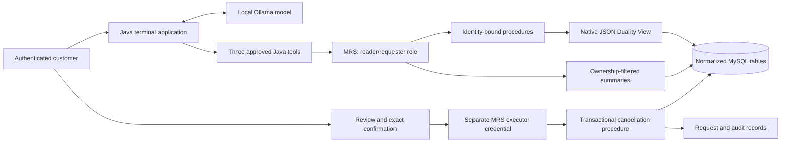

# Controlled order actions through MySQL REST Service

This follow-up reuses the original `customers`, `orders`, `order_items`, `products`, and **native MySQL JSON Duality Views**. A separate Java 25 client communicates exclusively over HTTPS with real MySQL REST Service. The agent has no JDBC driver, database password, arbitrary SQL tool, or cancellation-confirmation tool.

## Run locally

Requirements: Docker with Compose, Java 25, Maven, Python 3, OpenSSL, and a local Ollama model with tool support. Run these commands from the repository root.

```bash
bash scripts/mrs-up.sh
mvn -B -ntp -Dmaven.repo.local=.m2 -f mrs-agent/pom.xml package

export MRS_USER=alice
export MRS_PASSWORD='alice-Local!26'
java -jar mrs-agent/target/mrs-agent.jar --list
java -jar mrs-agent/target/mrs-agent.jar --read 1001
```

The script starts a **separate** Compose project, `order-duality-mrs`, with SQL on `127.0.0.1:3310` and HTTPS on `127.0.0.1:8443`. It reuses no volumes or containers from the original article. It refuses to overwrite a partially initialized schema. Re-running a completed setup preserves its data.

The local certificate is generated under ignored `.mrs/tls/`, with a private host directory and a mode-600 key. Bootstrap copies the key into the container's persistent database volume, owned by the MySQL OS user. Java and the Python probes verify the certificate and hostname. There is no `trustAll`, disabled hostname verification, or `curl -k` path. The certificate expires after 30 days; renewal and deployed secret management are outside this local demonstration.

These are disposable local-demo MRS accounts, not MySQL login accounts:

| Account | Password | Authority |
|---|---|---|
| `alice` | `alice-Local!26` | Customer 42 reads and cancellation requests |
| `bob` | `bob-Local!26` | Customer 43 reads and cancellation requests; the existing fixture customer's name is Mateo |
| `reader` | `reader-Local!26` | Customer 42 reads only |
| `executor` | `executor-Local!26` | Confirm an existing request; cannot read orders through the API |

For real inference, start Ollama and select an installed tool-capable model:

```bash
ollama serve  # omit if already running
ollama pull llama3.1:8b
export OLLAMA_MODEL=llama3.1:8b
java -jar mrs-agent/target/mrs-agent.jar --ask 'What is in my order 1001?'
java -jar mrs-agent/target/mrs-agent.jar --ask 'Request cancellation of order 1003 because I ordered it twice.'
```

Our recorded local run used the already-installed `llama3.1:latest`; see the evidence files for its actual output. Model tags can change and answers are not deterministic guarantees.

For confirmation, start interactive mode in a terminal:

```bash
export MRS_EXECUTOR_PASSWORD='executor-Local!26'
java -jar mrs-agent/target/mrs-agent.jar
```

Ask to cancel an order. The application prints a recorded `PENDING` request with its UUID. Enter `/confirm UUID`, inspect the order ID and reason, then type the exact `CONFIRM UUID` challenge. `/requests` lists owned requests; `/review UUID` inspects one; `/quit` exits. Noninteractive `--ask` cannot perform confirmation. `--requests` also works without a model.

Changing `MRS_USER` and `MRS_PASSWORD` changes the authenticated customer. There is no model-controlled `customerId` or CLI customer-scope override. Set `MRS_URL` and `MRS_CA` for a different service address/certificate. `MRS_PORT`, `MRS_SQL_PORT`, and `COMPOSE_PROJECT_NAME` can isolate another deployment.

Stop this demonstration with `docker compose -f compose.mrs.yml stop`. This preserves its volume. The original application still uses its original Compose file and database version.

## Architecture and trust boundaries



The model can call `listMyOrders()`, `getOrder(orderId)`, and `requestCancellation(orderId, reason)`. Java restricts a turn to eight tool calls and one distinct cancellation target. Tools receive an already-authenticated HTTP client and expose neither tokens nor identity arguments. Request retries within a turn reuse a Java-generated UUID.

MRS authenticates using its SCRAM-SHA-256 exchange over verified TLS. `@ROWOWNERSHIP` filters GET resources and injects the authenticated MRS principal into procedure parameters. In the spike, a forged `userId` was overwritten, not trusted. Procedures resolve that principal through `customer_principals`; business ownership is checked again inside SQL.

Endpoint definitions live in `mrs/endpoints.sql`. All endpoints require authentication:

| Endpoint under `/orders/shop` | Method | Role | Behavior |
|---|---|---|---|
| `/orders` and `/orders/{id}` | GET | reader | Up to 10 summaries; owner-filtered |
| `/requests` and `/requests/{uuid}` | GET | reader | Owner-filtered cancellation records |
| `/whoami` | POST | reader | Authenticated principal for trusted Java confirmation code |
| `/getOrder` | POST | reader | Reads the existing native document after SQL ownership filtering |
| `/requestCancellation` | POST | requester | Creates a pending request, leaving the order unchanged |
| `/confirmCancellation` | POST | confirmer | Checks caller role, owner, expiry, current state/version; commits cancellation and audit atomically |

MRS authorizes procedure POSTs using its `CREATE` privilege, even when the routine only reads. A SQL procedure's business denials return HTTP 200 with `{"ok":false,"code":"..."}` inside MRS's `resultSets` envelope. Endpoint-role failures are HTTP 403; inaccessible GET records are 404. Java preserves that distinction.

The routine owner, `order_workflow`, is a locked account. Its mutation grants cover only order status, cancellation requests, and audit insertion. MRS's provider role has column-limited summary access and EXECUTE on the approved routines; no generic order UPDATE endpoint exists. The original demo's API and agent SQL users are not installed in this new database.

## Cancellation contract

1. A request locks the order, checks the caller's customer mapping and eligible state (`PENDING` or `PROCESSING`), and records the order version, reason, ten-minute expiry, and retry key.
2. The human review path retrieves the request using the customer's token. Another customer's request UUID returns 404. The principal sent to the executor comes from authenticated `/whoami`, not an AI argument.
3. Confirmation uses a separately authenticated executor role. The procedure validates that executor, requester ownership, expiry, order state, and version under row locks. Every mutation locks the order before its request.
4. A successful transaction updates the order to `CANCELLED`, records `CONFIRMED`, and inserts one cancellation audit event. Repeated or concurrent confirmations return the same result without another cancellation event.

A concurrent eligible-order change invalidates the recorded version. Shipping makes cancellation ineligible. The race test uses a shipping update conditional on the order still being open; this example does not expose a shipping API or claim to implement warehouse integration.

## Compatibility findings

Tested with MySQL **26.10.0 Community**, its bundled MySQL Shell/MRS plugin, the in-server MRS component, and ARM64 Docker. The image is pinned by digest in `compose.mrs.yml`. MRS does not require a Router process for this deployment.

The existing native views load unchanged. MySQL rejects `CREATE VIEW ... AS SELECT data FROM orders_dv` with **6504**, so a conventional wrapper view cannot add an ownership column around that native document. The implemented path is a checked MRS procedure that queries `orders_dv` directly. Its nested JSON and native `_metadata.etag` reach Java intact. This is native duality through a procedure endpoint, not transparent REST CRUD over the duality view. Cancellation is a relational transaction, not a full-document replacement.

A definer-security join projection failed under the provider identity in this spike with a column-level SELECT denial. The final summary projection uses `SQL SECURITY INVOKER` and explicit provider column grants, which the live tests exercise. We have not established a general vendor defect from this observation. Updating/replacing metadata and roles during exploration also required a runtime restart before the revised permissions were observed; the clean bootstrap defines endpoints before installing the component.

MRS REST data mapping views (`CREATE REST VIEW`) and native server views (`CREATE JSON DUALITY VIEW`) are different mechanisms. This project intentionally documents which one is used at each endpoint.

References: [MRS component setup](https://dev.mysql.com/doc/dev/mysql-rest-service/latest/#installing-the-mrs-server-component), [MRS SQL reference](https://dev.mysql.com/doc/dev/mysql-rest-service/latest/sql.html), [authentication protocol](https://dev.mysql.com/doc/dev/mysql-rest-service/latest/restApi.html#authenticate-a-rest-user), and the bundled `mrs_plugin/sdk/python/mrs_base_classes.py` implementation used to check the SCRAM exchange.

## Verify

```bash
# Existing application: original unit tests.
mvn -B -ntp -Dmaven.repo.local=.m2 test

# New module: tool dispatch tests and real Java/MRS integration.
mvn -B -ntp -Dmaven.repo.local=.m2 -f mrs-agent/pom.xml verify -Pmrs-integration

# Raw REST calls, role/ownership bypass attempts, retries, expiry, and races.
python3 scripts/mrs-verify.py
```

The integration suites require the running MRS service. They fail rather than silently substituting a mock or skipping unavailable services. They create and remove their own fixture orders. SQL is used only by the test harness for fixture setup/readback; the application runtime has no JDBC dependencies. Captured results are in `docs/evidence/mrs/`; generated reports are in `target/mrs/` and `mrs-agent/target/`.

## Limits and what the boundary proves

Prompt injection can still persuade the model to choose an available tool or create an unwanted pending request. It cannot introduce an unregistered tool, obtain another customer's rows through these endpoints, or make the customer role execute confirmation. The tests force an attempted confirmation after malicious tool-returned content and independently test the backend role denial. Those are specific invariants, not proof of general prompt-injection immunity.

The executor is part of the trusted Java application. Compromise of that process or its executor credential can bypass the human interaction. A production deployment needing a stronger separation should put confirmation in a separate service and bind it to authenticated user consent. This CLI uses environment variables for demo secrets, not a production secret store.

Model prose can still be wrong. Our real read run supplied the right items and status but invented dollar signs despite the prompt. A scripted test also demonstrates that the model can claim cancellation while the authoritative record remains `PENDING`. The application prints the recorded request separately; only the confirmation response is evidence of a committed cancellation.

The original native-view query-plan concerns still apply. No scale or latency benchmark is claimed. MRS reduces endpoint plumbing, but ownership rules, cancellation policy, audit design, retries, and human interaction still require code. Payments, stock reservation, or transactions across services would need additional application-service orchestration.
